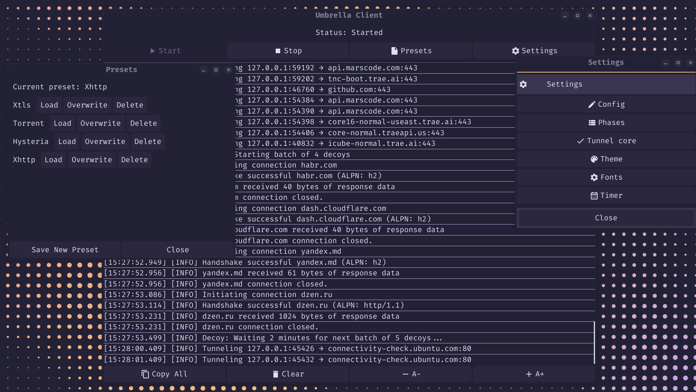

#  Umbrella Protocol

A comprehensive censorship circumvention solution that combines several different traffic masking strategies into one application. My experimental and research project.

---

## Core Architecture: Control Plane + Data Plane

Umbrella now strictly separates authentication from traffic routing to achieve **100% vanilla handshakes** and maximum resistance to traffic analysis:
1. **Control Plane (Out-of-Band)**: Clients activate their IP addresses and fetch the latest server configuration via a legitimate messaging service (e.g., Gmail IMAP). 
2. **Data Plane**: Once activated, the server routes traffic using completely standard protocol handshakes (TLS, QUIC, BitTorrent). No custom signatures, HMACs, or time-drift masks are embedded in the network packets.

[Learn more about the activation mechanism](./docs/activation.md)

---

## Umbrella Strategies

The project implements several protocols, each optimized for its own tasks and featuring custom enhancements (see more details in the respective .md files):

### 1. Hysteria 2

* **Base:** QUIC (UDP) with BBR congestion control.
* **Masking:** Masquerading as standard HTTPS + Custom Random padding at the packet level.
* **Reality-Like Fallback:** Unactivated connections are transparently forwarded to a legitimate destination (e.g., `samsung.com:443`), making the server indistinguishable from a standard proxy or the target service itself.
* [Details in hysteria.md](./docs/protocols/hysteria.md)

### 2. Torrent Stealth

* **Base:** uTP (UDP) over BitTorrent Piece-framing.
* **Masking:** Behavioral imitation of a torrent client + White Noise (tracker requests) + Random padding.
* **100% Vanilla Handshake:** The server responds with a standard BitTorrent handshake (e.g., `-TR4000-` client ID). Unactivated IPs are seamlessly transitioned into **Decoy Mode**, serving random data as if they were legitimate peers.
* [Details in torrent.md](./docs/protocols/torrent.md)

### 3. XHTTP

* **Base:** HTTP/2 (TCP) or HTTP/3 (QUIC/UDP).
* **Masking:** Masquerading as standard browser HTTPS traffic using legitimate ALPNs (`h2`, `h3`).
* **Zero-Signature Handshakes:** Unlike previous iterations, XHTTP no longer embeds magic fields in the TLS `SessionID` or QUIC `ConnectionID`. All handshakes are completely standard.
* **Double Padding:** Random noise is added to both HTTP headers (`X-Padding`) and data frames (`[DataLen][PaddingLen]`) to break statistical analysis.
* [Details in xhttp.md](./docs/protocols/xhttp.md)

---

## General Protection Technologies (for all protocols)

### Shaper

Dynamic traffic shaping. Allows imitating page load patterns, API calls, or simply limiting speed (Limiter) to avoid attracting attention with anomalous spikes.

[Details in shaper.md](./docs/shaper.md)

### Decoy Traffic

The Decoy module operates at the application level:
* Generates infrequent (once every 1-5 minutes) direct requests to popular resources (Bing, Yahoo, Apple, Intel, etc.).
* Blurs IP connection statistics in the eyes of the ISP: your IP communicates not only with the VPS but also with a dozen legitimate global services.
* Low traffic consumption without sacrificing stealth.

---

## Umbrella Server

The server supports all modes. The configuration is flexibly adjustable to the chosen protection strategy.

[Server setup details in setup_guide.md](./docs/setup_guide.md)

---

## Umbrella Client (Fyne UI)

A modern graphical interface providing full control over the tunnel and system settings.

### Main features and windows:

* **Main Screen**:
  + Large Start/Stop button for instant control.
  + Virtualized log (widget.List) with support for copying lines on click.
  + Status indicators and current mode.
  + Quick control of log font size.
* **Settings Window**:
  + **Config Editor**: Built-in `config.yaml` editor (structure validation before saving).
  + **Phase Editor**: Configuring Shaper behavior through a phase editor.
  + **Presets**: A system for saving and instantly switching between setting profiles.
  + **Tunnel Core**: Integration with third-party tools (Mihomo, sing-box, ProxiFyre).
* **Personalization**:
  + **Themes**: Choice of several predefined themes.
  + **Fonts**: Ability to install custom fonts (.ttf/.otf) for the entire interface.
* **Tools**:
  + **Timer**: Automatic tunnel shutdown on schedule.

---

## Masking Tips

### For Torrent

* Specify the hash of a popular torrent (e.g., a current Ubuntu or Debian image) in `info-hash`.
* If your VPS allows, use a wide range of ports in `port` to simulate natural peer switching.

---

## Build and Usage

[Full instructions for building, deploying, and configuring are provided in setup_guide.md](./docs/setup_guide.md)

* **The client must be run as administrator (or with `sudo` on Linux) to correctly launch Mihomo, sing-box, and ProxiFyre. When manually launching tunneling tools, it can be run without administrator privileges.**
* **Sometimes errors occur related to a blocked port (even if no one is using it). If the application doesn't handle it automatically, the commands `net stop winnat && net start winnat` (Windows) and `sh -c fuser -k 1080/tcp` (Linux) will help.**

---
